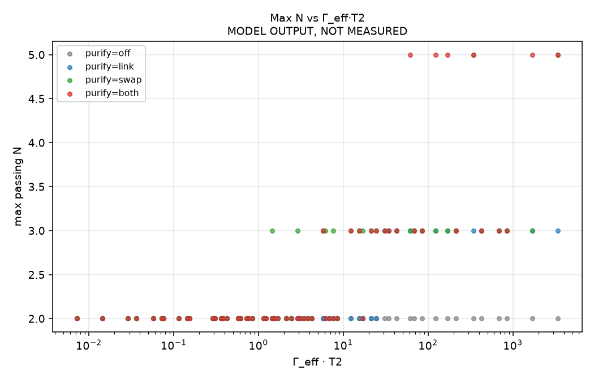
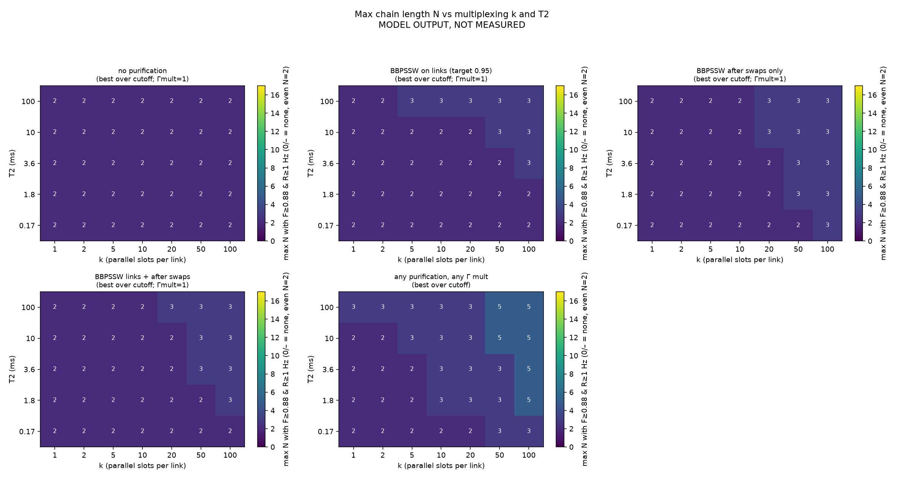

# Where do quantum repeater chains break? Findings from a simple memory-decoherence model, and open questions

**Bob Busby (with AI assistants)** · Technical note, draft of October 16, 2026

> **Model output, not measurement.** Every chain-level number in this note comes from a simple analytic model under stated assumptions. None of it was measured on hardware. Published experimental values are quoted only as they appear in a full-text check of the sources (Section 7), with that check's corrections.

## 1. What the model is

We asked where a chain of N quantum-memory nodes (N − 1 links) stops delivering useful end-to-end entanglement, and which parameter limits it first. The model is a small analytic mean-time calculation in Python, not an event simulation:

- **Links.** Each elementary link is heralded at rate Γ and delivers a **Werner state** of fidelity F_link. We write F = (1 + 3w)/4.
- **Memory decay.** A stored pair loses Werner weight while it waits for its partner link. The gap Δ is taken as exponential with mean τ, and the weight is multiplied by the average E[exp(−Δ/T2)] = 1/(1 + τ/T2). Only the earlier-arriving pair idles at each swap.
- **Swapping.** Ideal, deterministic Bell measurement: w_out = w_a · w_b. Nested scheduling when N − 1 is a power of two, sequential otherwise.
- **Purification.** Optional **BBPSSW** recurrence (re-twirled to Werner every round), target F = 0.95, up to 8 rounds. It can be applied to links, after swaps, or both. The rate pays for the consumed pairs. A per-round depolarizing residual of 0.01 is a tuned value with no source.
- **Multiplexing.** k parallel attempt slots per link. A link is ready at the earliest of k arrivals, so Γ_eff = k · Γ (times an optional rate multiplier).
- **Temporal cutoff.** Optionally, a pair is discarded after waiting longer than m · T2 (m = 0.5, 1 or 2).

"Useful" means **F_e2e ≥ 0.88 and R_e2e ≥ 1 Hz**. This is a reporting threshold we chose, not a physical constant. The starting point is a node budget sketch with T2 = 3.6 ms, Γ = 85 Hz and F_link = 0.887 (Section 4 explains why this point is optimistic). A grid sweep covers k ∈ {1…100}, T2 ∈ {0.17, 1.8, 3.6, 10, 100} ms, a rate multiplier ∈ {0.5…4}, the cutoff settings and the purification modes, for N = 2…17. (35,840 rows).

## 2. Main finding: chains break on waiting time, measured against memory time

- **The key ratio is Γ_eff · T2.** In the baseline, Γ · T2 ≈ 0.31. The mean wait for a partner link (1/Γ ≈ 11.8 ms) is longer than T2. After the first swap, end-to-end fidelity falls well below threshold: at N = 3 without purification the model gives F ≈ 0.38.
- **Purification is required for N ≥ 3, whatever the memory.** Even with zero idle time, swapping two F = 0.887 Werner links gives F ≈ 0.791 < 0.88. Longer T2, a cutoff or more slots cannot fix this alone.
- **Purification only works when there is rate to spare.** Each purified level multiplies the number of raw pairs needed. In the sweep, the N = 3 passes sit at Γ_eff · T2 from about 1.5 (shortest T2, with a cutoff) to over 100. Extending T2 stops helping much once Γ_eff · T2 reaches roughly **20–50**. Beyond that point the rate budget, not decoherence, sets the limit. N = 5 needs Γ_eff · T2 of roughly 25 to 10⁴, depending on T2 and on the idle model.
- **Multiplexing is the strongest lever in the model.** Raising k (or the per-slot rate) raises Γ_eff directly. A cutoff matters only at the shortest T2, and T2 above about 10 ms barely changes the Γ_eff needed for N ≥ 5.



*Figure 1 (model output). Largest passing N for each sweep configuration against Γ_eff · T2, coloured by purification mode. Without purification (grey), nothing gets past N = 2 at any Γ_eff · T2. N = 3 appears from Γ_eff · T2 ≈ 1.5 when purification is used, and N = 5 only above about 60, with purification on both links and swaps. This sweep uses a per-slot success probability above every published value (see Section 3), so it shows what the model needs, not what hardware can do.*



*Figure 2 (model output). Largest passing N over k (slots) and T2, per purification mode; same caveat as Figure 1. With any rate multiplier (last panel), N = 5 appears only at k ≥ 50 and T2 ≥ 1.8 ms. N = 9 and 17 appear in no panel.*

## 3. Results against published parameter bands

We tagged every sweep row by whether its T2, slot count k and per-attempt success probability p fall inside published values. These **revised bands** follow the full-text source check:

- **Published:** p ≤ 3×10⁻⁵ (the only published p at F ≈ 0.8), k = 1, T2 ≤ 10 ms (10 ms only at ≈ 50 mK).
- **Plausible:** p up to 2.5×10⁻⁴ (published only at F ≈ 0.56–0.60), k = 2–40, T2 = 10–100 ms.
- **Beyond published:** anything above those values.

A row's tier is its worst axis.

| Tier (revised bands) | Max passing N, default idle model | Max passing N, stricter idle model |
|---|---|---|
| Published | **0** (not even one link) | 0 |
| Plausible | **2** (a single link) | 2 |
| Beyond published | **5** | 4 |

**N = 9 and N = 17 pass nowhere** in the grid. Extrapolating beyond the grid, the model would need Γ_eff of about 2.5×10⁵ Hz for N = 9 and about 8×10⁶ Hz for N = 17 (default idle model).

Plainly read:

- **Published tier, max N = 0.** At p ≈ 3×10⁻⁵ with one slot, even a single link stays under 1 Hz in this model.
- **Plausible tier, max N = 2.** The single link passes only because F_link = 0.887 is a model *input*. Among the sources we checked, no published solid-state link combines F ≥ 0.88 with R ≥ 1 Hz.
- **N = 3 needs beyond-published values.** It passes only with p ≈ 0.028 and T2 = 100 ms under optimistic link-level purification. The N = 5 pass needs k = 50 and the same p.

## 4. Limitations (please read before quoting anything)

- **Not modelled:** fibre loss or distance (so no comparison with the repeaterless bound is possible), node power and cryostat load, crosstalk between slots, the memory cost of k slots (at least 2k per node), communication latency and local gate errors.
- **Link-level purification is optimistic.** A copy waiting for its partner copy is charged no storage decay. A stricter idle mode exists ("full"), but it is only a partial fix. All purified rows are best read as upper bounds.
- **The idle model is a choice.** T2 (a dephasing time) is applied as a depolarizing decay, with one factor per pair. Pure dephasing would floor at F = 0.5, not 0.25. A per-qubit treatment would be harsher. Werner states are an idealisation, and BBPSSW converges more slowly than DEJMPS.
- **The baseline is a budget sketch, not a design.** Its p = 0.0071 is about **28× above** the best published p (≈ 2.5×10⁻⁴, at F ≈ 0.56) and about 200× above the published point near F ≈ 0.8. Its T2 = 3.6 ms is above the published SnV⁻ value at 1.7 K, and its Γ = 85 Hz includes an undocumented ×2.4 factor over attempt rate × p. In the sweep, "p" is simply the baseline p times the rate multiplier, not a separate physical axis.

## 5. Open questions, and data that would help

1. **Measured p versus F on one link.** Published points trade rate for fidelity (Section 7). A full p(F) curve for a single solid-state link, including overheads, would let the model use a real trade-off instead of a fixed F_link.
2. **Multimode memory–memory entanglement at useful fidelity.** The model leans hardest on k. Is there a demonstration of k > 1 simultaneously stored, heralded memory–memory pairs at F ≳ 0.8, in real time and not by post-processing? We did not find one in the sources we checked.
3. **Purification with storage decay included.** Experimental or detailed theoretical results on recurrence purification where the copies decohere while they wait would replace our most optimistic assumption.
4. **Entanglement storage time versus single-spin T2.** Published entanglement storage can be shorter than single-spin coherence (Section 7). What is the right memory-time input for a cutoff?
5. **Model review.** Would a better dephasing model, a Monte-Carlo scheduler or DEJMPS change the picture? We expect the main finding to hold but have not shown it. Corrections and counter-examples are welcome.

## 6. Reproducing the results

The code is not yet published. It lives in a private working directory (`querp-multinode-sim/`), and Bob Busby will decide how to share it. It needs Python 3 with numpy and matplotlib:

```
python -m venv .venv && . .venv/bin/activate
pip install -r requirements.txt
python simulate.py --n-max 17              # baseline chain, N = 2..17
python sweep.py                            # full grid -> artifacts/sweep_*
python sweep.py --idle-mode full           # stricter idle sensitivity
python classify_sweep.py --revised         # published-band tiers
python tests/test_sanity.py && python tests/test_sweep.py
```

The tests check that N = 2 returns R = Γ and F = F_link exactly, and that zero-idle N = 3 gives F = 0.791.

## 7. Published values used (as checked in full text, arXiv versions)

Read in the arXiv full texts; the Nature versions were not read, and final published numbers could differ slightly.

- **Knaut et al., Nature 2024, arXiv:2310.01316 (SiV).** Per-attempt heralding 7.7×10⁻⁶ – 2.5×10⁻⁴. *Corrected:* "~1 Hz at F = 0.86" conflates two points. Average fidelity is ≈ 0.80 at ≈ 20 mHz and ≈ 0.56 at ≈ 1 Hz (read off a figure, approximate); 0.86 is one Bell state at the lowest rate. *Corrected:* the 35 km deployed nuclear link averages ≈ 0.23 mHz (F = 0.69(7) with error detection); 6 mHz is a short-fibre run. Nuclear T2 is ≈ 2.1 s, but remote entanglement storage is ≈ 0.5 s (≈ 1 s with error detection). The ≈ 0.95 and ≈ 100 Hz figures are the authors' separate projections.
- **Humphreys et al., Nature 2018, arXiv:1712.07567 (NV).** 6 Hz at F = 0.81(2) and 39 Hz at F = 0.60(2), both attempt-limited. *Corrected:* p is not reported directly; ≈ 3×10⁻⁵ (F 0.81) and ≈ 2×10⁻⁴ (F 0.60) are derived. The supplement was not available.
- **Liu et al., Nature 2021, arXiv:2101.04945 (Nd:YVO₄).** Memory–memory F = 80.4 ± 2.2 %, about 4 temporal modes stored at once (≈ 56 is a stated potential), ≈ 1.1 entanglements per hour.
- **Lago-Rivera et al., Nature 2021, arXiv:2101.05097 (Pr:YSO).** Heralding up to 1.43 kHz. *Corrected:* "62 modes" is a post-processed count, not real-time multiplexing. Raw concurrence is ≈ 1.15×10⁻², and the "effective fidelity" 0.92 excludes the vacuum term, so it is not comparable to Bell-state fidelities.
- **Karapatzakis et al. 2024, arXiv:2403.00521 (SnV⁻).** T2 = 10(1) ms with CPMG-64 at 50 mK. Caveat: the fit uses a stretched exponent fixed at 4 on data normalised to 0.5, measured only up to 64 pulses.
- **Guo et al. 2023, arXiv:2307.11916 (SnV⁻).** T2 = 1.57(8) ms with CPMG-128 at 1.7 K.
- **Resch, Karapatzakis et al. 2025, arXiv:2509.03354 (¹³C on SnV⁻).** Nuclear T2 = 1.35(3) s with CPMG-128 at 50 mK. This is single-spin coherence only: no spin–photon or remote entanglement was shown. We do not combine it with electron-spin link numbers.

The grid's T2 = 0.17 and 1.8 ms points come from an earlier review of SnV⁻ literature and were not re-checked in this full-text pass.

*Acknowledgement:* the modelling code, review and source check were done with AI assistants (Grok Bot, AEON). All errors are the author's.
